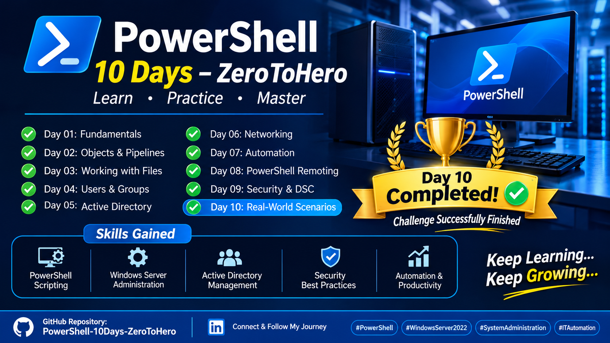

# PowerShell – 10 Days: Zero to Hero



<p align="center">
  <strong>Learn • Practice • Automate • Improve</strong>
</p>

<p align="center">
  
  
  
  
</p>

---

## 1. Project Overview

Welcome to my **PowerShell – 10 Days: Zero to Hero** learning challenge.

This project documents my practical journey of developing PowerShell skills for Windows Server administration, IT operations, troubleshooting, and automation.

The main objective is to strengthen my ability to manage Windows environments through PowerShell commands and scripts rather than relying entirely on graphical interfaces.

Throughout this challenge, I will work with practical scenarios, hands-on labs, documentation, and automation tasks.

**Primary Focus:**
- Windows Server Administration
- Active Directory Management
- DNS and DHCP Administration
- File System and NTFS Permissions
- Network Administration
- PowerShell Remoting
- PowerShell Scripting and Automation

## 2. Project Objectives

- Develop practical PowerShell administration skills.
- Automate repetitive Windows administration tasks.
- Manage Active Directory users and groups.
- Monitor and troubleshoot Windows Server environments.
- Understand PowerShell scripting concepts.
- Build reusable scripts for real-world IT scenarios.
- Document practical work through GitHub.

## 3. 10-Day Learning Roadmap

| Day | Topic | Focus |
|---|---|---|
| 01 | PowerShell Fundamentals | Commands, versions, help and execution policy |
| 02 | Objects, Pipelines & Filtering | Objects, Where-Object, Select-Object and Sort-Object |
| 03 | File System & NTFS Permissions | Files, folders, ACLs and permissions |
| 04 | Processes, Services & Event Logs | Monitoring and troubleshooting |
| 05 | Network Administration | IP, DNS, connectivity and network adapters |
| 06 | Active Directory Automation | Users, groups and organizational units |
| 07 | DNS, DHCP & Windows Server Management | Server administration |
| 08 | PowerShell Remoting | Remote server management |
| 09 | Advanced PowerShell Scripting | Variables, functions, loops and error handling |
| 10 | Real-World Automation Project | Practical System Administration project |

## 4. Skills Demonstrated

The following skills are the main learning targets of this challenge. Their completion will be documented through practical evidence.

- PowerShell command-line administration
- Windows Server management
- Active Directory administration
- DNS and DHCP management
- NTFS permissions management
- Network troubleshooting
- Windows Services and Process monitoring
- Event Log analysis
- PowerShell Remoting
- Scripting and task automation

## 5. Practical Labs & Documentation

Each day includes theoretical notes, PowerShell commands, practical exercises, and screenshots.

### Day 01 – PowerShell Fundamentals

**Topics Covered:**
- PowerShell architecture and versions
- Cmdlet naming conventions (Verb-Noun)
- Get-Command and Get-Help
- System information
- Windows Services
- Process management
- Execution Policy

**Practical Commands:**

```powershell
$PSVersionTable

Get-ComputerInfo |
Select-Object CsName, WindowsProductName, WindowsVersion

Get-Service

Get-Process
```

**Screenshots:**

| Practical Lab | Screenshot |
|---|---|
| PowerShell Version | lab1-version.png |
| System Information | lab1-sysinfo.png |
| Windows Services | lab1-service.png |
| Process Management | lab1-process.png |

**Documentation:** [Day 01 – PowerShell Fundamentals](Days/Day-01-Fundamentals/README.md)

**Status:** In Progress

---

### Day 02 – Objects, Pipelines & Filtering

Topics:
- PowerShell Objects
- Pipeline operations
- Where-Object
- Select-Object
- Sort-Object
- Measure-Object
- ForEach-Object

**Status:** Planned

---

### Day 03 – File System & NTFS Permissions

Topics:
- File and directory management
- New-Item, Copy-Item and Move-Item
- Get-Acl and Set-Acl
- NTFS permissions

**Status:** Planned

---

### Day 04 – Processes, Services & Event Logs

Topics:
- Process monitoring
- Windows Services
- Service troubleshooting
- Event Viewer with PowerShell
- Get-WinEvent

**Status:** Planned

---

### Day 05 – Network Administration

Topics:
- IP configuration
- Network adapters
- DNS resolution
- Connectivity testing
- Network troubleshooting

**Status:** Planned

---

### Day 06 – Active Directory Automation

Topics:
- Active Directory PowerShell module
- User management
- Group management
- Organizational Units
- User account administration

**Status:** Planned

---

### Day 07 – DNS, DHCP & Windows Server Management

Topics:
- DNS administration
- DNS records
- DHCP scopes and leases
- Windows Server administration

**Status:** Planned

---

### Day 08 – PowerShell Remoting

Topics:
- WinRM fundamentals
- Remote PowerShell sessions
- Enter-PSSession
- Invoke-Command
- Remote server administration

**Status:** Planned

---

### Day 09 – Advanced PowerShell Scripting

Topics:
- Variables and data types
- Conditional statements
- Loops
- Functions
- Error handling
- Reusable scripts

**Status:** Planned

---

### Day 10 – Real-World Automation Project

The final day will combine the skills developed throughout the challenge into a practical Windows Server administration project.

The final project will be selected based on the labs completed during the challenge.

**Planned Deliverables:**
- PowerShell automation script
- Practical demonstration
- Execution results
- Screenshots
- Technical documentation

**Status:** Planned

---

## 6. Final Project

At the end of this challenge, I will develop a practical PowerShell automation project focused on Windows Server administration.

The project will demonstrate how PowerShell can simplify repetitive administrative tasks, improve efficiency, and support system management.

The final implementation and results will be documented here after completion.

## 7. Tools & Technologies

| Technology | Purpose |
|---|---|
| Windows Server 2022 | Server Administration |
| Windows PowerShell 5.1 | PowerShell Administration |
| VMware Workstation Pro | Virtual Lab Environment |
| Windows 11 | Client Environment |
| Active Directory | Identity and Access Management |
| DNS | Name Resolution |
| DHCP | IP Address Management |
| GitHub | Documentation and Version Control |

## 8. Repository Structure

```text
PowerShell-10Days-ZeroToHero/
│
├── README.md
│
├── Days/
│   ├── Day-01-Fundamentals/
│   │   ├── README.md
│   │   └── Commands.ps1
│   │
│   ├── Day-02-Objects-Pipelines/
│   ├── Day-03-FileSystem-NTFS/
│   ├── Day-04-Processes-Services-Logs/
│   ├── Day-05-Network-Administration/
│   ├── Day-06-Active-Directory/
│   ├── Day-07-DNS-DHCP/
│   ├── Day-08-PowerShell-Remoting/
│   ├── Day-09-Advanced-Scripting/
│   └── Day-10-Automation-Project/
│
└── Screenshots/
    ├── Day-01/
    ├── Day-02/
    ├── Day-03/
    ├── Day-04/
    ├── Day-05/
    ├── Day-06/
    ├── Day-07/
    ├── Day-08/
    ├── Day-09/
    └── Day-10/
```

## 9. Learning Philosophy

**Learn by doing. Document every lab. Build practical skills.**

This repository represents my commitment to continuous learning and professional development in System Administration and IT Automation.

Every command, script, and practical exercise is an opportunity to improve my technical knowledge.

---

**Project:** PowerShell – 10 Days: Zero to Hero

**Focus:** System Administration & Automation

**Platform:** Windows Server 2022

**Author:** Abdirahman Abdulahi Kasim

